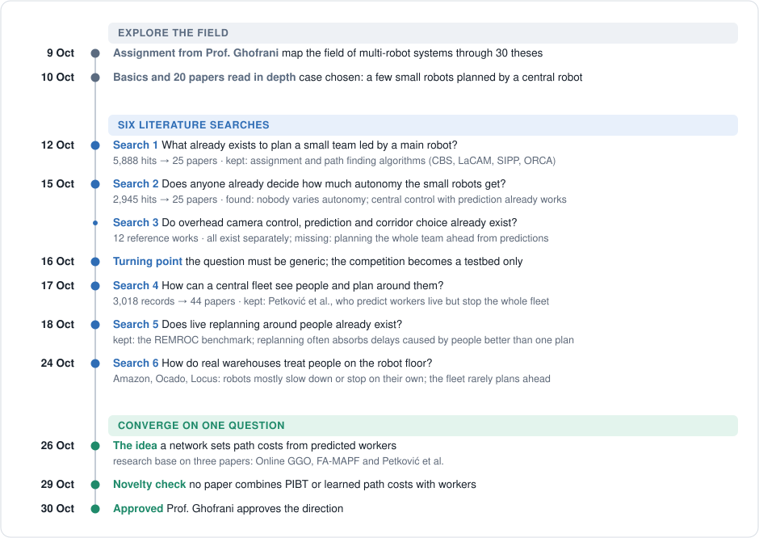

# Learned path costs for a warehouse fleet shared with workers

Research recap and project plan.

## 1. Summary

In many warehouses, robots and people share the same floor. Central fleet planners are fast, but they treat workers as obstacles to react to, not as people whose next steps can be predicted.

This project tests a simple idea. A small neural network, trained offline by an evolutionary algorithm, sets the path costs of the warehouse every few seconds from two inputs: the current robot traffic and the predicted positions of the workers. The fast planner PIBT then follows these costs. The aim is a better tradeoff: as many completed tasks as possible, with fewer close passes between robots and workers.

The idea combines three papers. Each solves one part of the problem and leaves one gap:

| Paper | What it solves | What it leaves open |
|---|---|---|
| Online GGO (Zang et al., AAAI 2025) | A network sets path costs online, and PIBT follows them | No people |
| FA-MAPF (Heuer et al., ICRA 2026) | Human motion patterns become path costs | Costs computed once, from past data |
| Petković et al. (MED 2020) | Worker intentions are predicted live | The whole fleet stops at each deviation |

Prof. Ghofrani approved the direction on 30 October 2026. This document is the starting plan.

## 2. Research journey

How the direction narrowed:

- **A concrete case first, then a generic question.** The first searches used the Coupe de France de Robotique as a case: small robots planned by a main robot. On 16 October the question was made generic, and the competition can now only serve as a testbed.
- **From robots alone to robots among people.** Search 4 moved to warehouse fleets that share the floor with workers. Petković et al. (2020) predicted worker intentions live, but stopped the whole fleet at each deviation.
- **From stopping to steering.** The aim became to keep the fleet moving and to shape its paths around predicted workers, at a computing cost that a fast planner can afford.
- **From hand-set costs to learned costs.** Online GGO and FA-MAPF showed that path costs can steer a fleet: learned online for robots alone, or computed once from human flows. Combining the two gave the research question.

## 3. The three base papers

### Online GGO, Zang et al., AAAI 2025

[Online Guidance Graph Optimization for Lifelong Multi-Agent Path Finding](https://arxiv.org/abs/2411.16506)

- **What it does:** every 20 steps, a small CNN (3,119 weights) reads the recent robot traffic and goals, then resets the cost of every move. PIBT follows these costs. The network is trained offline by CMA-ES to maximise throughput.
- **Key result:** up to +30.75 % throughput over costs optimised offline. With 600 robots: 8.66 tasks per step, against 6.42 with offline costs and 3.18 without guidance.
- **Leaves open:** there are no people; only the robot traffic changes.
- **We take:** the whole loop. A network sets path costs online, CMA-ES trains it, and PIBT follows the costs.

### FA-MAPF, Heuer et al., ICRA 2026

[Conflict Mitigation in Shared Environments using Flow-Aware MAPF](https://arxiv.org/abs/2603.12736)

- **What it does:** learns from past trajectories where people usually walk and in which direction (a map of dynamics). It then adds a cost to robot moves that go against these flows.
- **Key result:** up to −55 % conflicts with people when they follow directed flows, but only −23 % when they walk randomly.
- **Leaves open:** the costs are computed once, from past data, with no live information on where people are going now.
- **We take:** the form of the cost: step cost plus a human term that depends on direction.

### Petković et al., MED 2020

[Human Intention Recognition for Human Aware Planning in Integrated Warehouse Systems](https://arxiv.org/abs/2005.11202)

- **What it does:** when a worker leaves the path they were given, a hidden Markov model infers their destination among a few possible goals. The whole fleet then stops and is replanned around them.
- **Key result:** with 3 workers, +29 % total deliveries over simple reaction; with 1 worker, −91 % encounters.
- **Leaves open:** every deviation stops all the robots. It was tested with at most 3 workers, in a small evaluation.
- **We take:** live prediction of where each worker is going, and stop-and-replan as a reference method to compare against.

## 4. How Claude was used

I used Claude, Anthropic's AI assistant, throughout the research. I am trying to keep a fair balance between using AI and following a proper scientific method.

- **Searching together:** Claude ran the six literature searches on OpenAlex, arXiv and the web, from what I asked for. Between two searches we discussed the results back and forth. I compared them with what I know and have experienced, pointed out what I was missing, and brought my own ideas. The next search came out of that discussion.
- **Terminology:** I often knew a concept but not its name in the literature. Claude re-explained terms such as MAPF, CBS or PIBT.
- **Checking novelty:** I asked several times to check that we were not trying to solve something already solved elsewhere. The last check, on 29 October, used forward citations on Semantic Scholar and OpenAlex.
- **Deciding:** at each step, I decided where to go next and what to try.
- **Building the test environment (next step):** Claude will also help me develop the simulator used for the experiments. I will review the code, and above all supervise the parts tied to the research question: the cost network, its training, the compared methods and the measurements.

**Limit.** I review Claude's work alone, and Claude does a large share of the work. A mistake made by either of us could go unnoticed. To limit this, every number in this document is tied to a section or table of its paper, and every search is logged with its queries, counts and decisions, so that someone else can check it.

## 5. Research questions

**Main question:** Can a small neural network evolved to set path costs online from robot traffic and predicted worker positions give a warehouse fleet shared with people a better tradeoff between throughput and close passes than path costs set by hand or learned without workers?

**In plain words:** does our network help robots deliver as much or more while passing close to people less often, better than the settings that already exist?

Two terms come back everywhere:

- **Close pass:** time a robot spends within 1 cell of a worker. Fewer close passes means a safer floor.
- **Slider w:** the weight in the score the network is trained on, score = tasks per minute − w × close-pass seconds per minute. A low w rewards a fleet that pushes through; a high w rewards a fleet that goes around people.

### SQ1, the gain

- **Question:** Does our network make robots pass close to workers less often than the three other ways of setting costs, without delivering less?
- **We compare:** a fixed penalty near workers, static flow costs as in FA-MAPF, and guidance learned without workers as in Online GGO.
- **Hypothesis H1:** yes, against all three. The gap over static flow costs grows when workers leave their habits, because static costs only know the habits.
- **Basis:** FA-MAPF Table I: −55 % conflicts with directed walkers, only −23 % with random walkers.

### SQ2, the slider w

- **Question:** Can one network that is told the slider position w do as well as several networks each trained for a single position?
- **We compare:** one all-in-one network against specialists trained for w = 0.1, 0.5 and 2.
- **Hypothesis H2:** yes, within 5 % at every position. The slider could then be changed live, without retraining.
- **Basis:** Mason and Hauert 2023, who give objective weights to the network as inputs.

### SQ3, generalisation

- **Question:** Does our network keep its advantage in situations never seen in training: more or fewer robots and workers, other warehouse layouts, other ways of walking?
- **We compare:** the same methods as SQ1, without ever retraining the network.
- **Hypothesis H3:** yes for the number of robots and workers and for walking modes. For a very different layout, only if the network was trained on several maps.
- **Basis:** Online GGO Fig. 4; evolved controllers tend to overfit their training conditions (Hasselmann et al. 2021).

### SQ4, the computing cost

- **Question:** How often must the costs be recomputed, and how much planning time does that add per cycle?
- **We compare:** recomputing every 2.5, 5 or 10 s; the planning time of our method against space-time A* with selective replanning.
- **Hypothesis H4:** every 5 to 10 s is enough, and our method plans faster than space-time A* from medium robot density on.
- **Basis:** Online GGO App. B.3: recomputing more often raises throughput but also computing time.

## 6. What we will build

Everything runs in a simulator that we build first. The method itself is a loop: every few seconds the network reads the floor and sets new path costs, and PIBT follows them at every step.

| Component | What it does | Taken from |
|---|---|---|
| Warehouse simulator | Grid floor where one cell holds one robot or one worker. One step lasts 0.5 s. A robot gets a new task as soon as it finishes one | Lifelong MAPF setting, as in Online GGO |
| Worker models | Workers walk by habit, in directed flows, freely, or along assigned trips | FA-MAPF (random, directed and speed walkers); Petković et al. (assigned paths) |
| Intention filter | Guesses each worker's destination among known goals from their recent steps, and predicts where they will be in the next seconds | Petković et al. (hidden Markov model over goals) |
| Planner | PIBT moves every robot one step at a time, and ranks each robot's moves by move cost plus guided distance to its goal | Okumura et al. (PIBT); Online GGO §3.1 |
| Cost network | A small CNN reads a map of the floor (robot traffic, goals, predicted workers and their walking direction, the slider w) and outputs 5 costs per cell: 4 moves and wait. A zero output gives plain PIBT | Online GGO (network, App. A.2); FA-MAPF (step cost + human term, Eq. 3); Mason and Hauert (w as input) |
| Training | CMA-ES tries variants of the network weights, plays each one on several seeds and keeps the best by score | Online GGO §3.2 |
| Reference methods | Fixed penalty, static flow costs, guidance without workers, space-time A* with selective replanning, stop-and-replan | Defined in section 7 |

## 7. What we test and how we verify

### Methods compared

M1 to M6 are methods: complete strategies that we compare. PIBT, A*, the CNN and CMA-ES are algorithms they use.

| Method | Planner and how it handles workers | Role |
|---|---|---|
| M1 | PIBT + fixed penalty near predicted workers | Baseline |
| M2 | PIBT + static flow costs, built from recorded worker trajectories as in FA-MAPF | Baseline |
| M3 | PIBT + guidance learned without workers, as in Online GGO | Baseline |
| **M4** | **PIBT + guidance learned with workers** | **Our method** |
| M5 | Space-time A* + selective replanning of the robots a worker affects | Reference |
| M6 | Space-time A* + global stop at each worker deviation, as in Petković et al. | Reference |

### Experiments

Densities are shares of the free floor cells.

| Sub-question | Experiment | What varies |
|---|---|---|
| SQ1 | Main comparison | The six methods, in the training conditions |
| SQ2 | Slider front | w from 0.1 to 2; the all-in-one network against the specialists |
| SQ3 | Transfer | Robot density from 2 to 12 %, worker density from 0.25 to 1 %, unseen maps, unseen walking modes |
| SQ4 | Computing cost | Recomputing every 2.5, 5 or 10 s; planning time of M4 and M5 as robot density grows |

### What we measure

| KPI | Unit | Answers |
|---|---|---|
| Throughput | tasks/min | SQ1 to SQ3 |
| Close-pass time | s/min | SQ1 to SQ3 |
| Score at w | throughput − w × close-pass time | SQ1 to SQ3 |
| Front gap | % | SQ2 |
| Safety stops per task, robot–worker conflicts | stops/task, conflicts/step | Comparison with Petković et al. and FA-MAPF |
| Worker blocked time, worker trips | s/task, trips/min | Effect on people |
| Planning time, mean and 95th percentile | ms | SQ4 |

### When a hypothesis counts as supported

| Hypothesis | Supported if |
|---|---|
| H1 | M4 beats M1, M2 and M3 on the score at w = 0.5 (p_Holm < 0.05), with less close-pass time and no lower throughput. Its margin over M2 is larger with free walkers than with habit walkers |
| H2 | At every w, the all-in-one network is within 5 % of the specialist for that w |
| H3 | M4 keeps a significant margin over M1 and M2 at every density and walking mode, and is at least level with M1 on unseen maps |
| H4 | Recomputing every 5 s is within 5 % of every 2.5 s, and M4's 95th percentile planning time is below M5's from 4 % robot density |

### How we verify

- Every method plays the same seeds: 30 seeds per condition, never used in training.
- Paired Wilcoxon signed-rank tests between M4 and each other method, with Holm correction within each family of tests. Each comparison reports the median difference, its bootstrap 95 % interval and the number of seeds won.
- Calibration first: each replica of a published setup must reproduce its paper's baseline before any comparison. For example, the Online GGO warehouse without guidance should give 3.18 tasks per step.
- The unseen test conditions are fixed before training starts.

## 8. References

- Zang, Zhang, Jiang, Chen, Harabor, Stuckey, Li. *Online Guidance Graph Optimization for Lifelong Multi-Agent Path Finding.* AAAI 2025. [arXiv:2411.16506](https://arxiv.org/abs/2411.16506)
- Heuer, Zhu, Palmieri, Rudenko, Mannucci, Koenig, Magnusson. *Conflict Mitigation in Shared Environments using Flow-Aware MAPF.* ICRA 2026. [arXiv:2603.12736](https://arxiv.org/abs/2603.12736)
- Petković, Hvězda, Rybecký, Marković, Kulich, Přeučil, Petrović. *Human Intention Recognition for Human Aware Planning in Integrated Warehouse Systems.* MED 2020. [arXiv:2005.11202](https://arxiv.org/abs/2005.11202)
- Okumura, Machida, Défago, Tamura. *Priority Inheritance with Backtracking for Iterative Multi-agent Path Finding.* Artificial Intelligence, 2022. [arXiv:1901.11282](https://arxiv.org/abs/1901.11282)
- Mason, Hauert. *Evolving Multi-Objective Neural Network Controllers for Robot Swarms.* 2023. [arXiv:2307.14237](https://arxiv.org/abs/2307.14237)
- Hasselmann, Ligot, Ruddick, Birattari. *Empirical assessment and comparison of neuro-evolutionary methods for the automatic off-line design of robot swarms.* Nature Communications 12, 2021. [doi:10.1038/s41467-021-24642-3](https://doi.org/10.1038/s41467-021-24642-3)
- Heuer, Palmieri, Mannucci, Koenig, Magnusson. *Benchmarking Multi-Robot Coordination in Realistic, Unstructured Human-Shared Environments* (REMROC). ICRA 2024.
